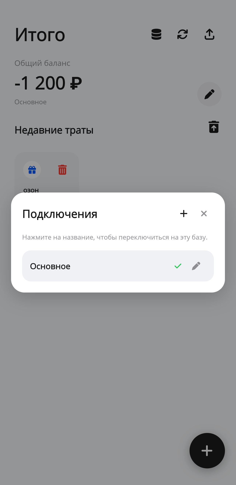
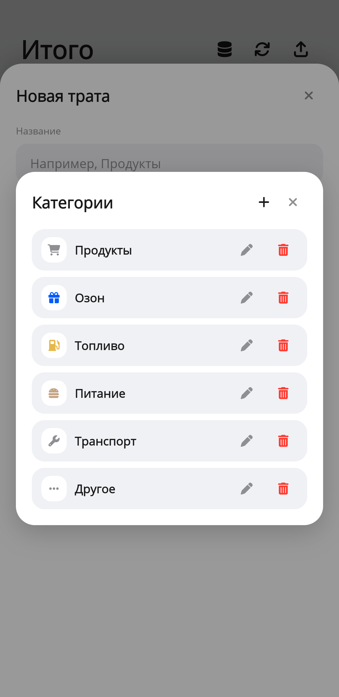

# Duty — учёт трат на .NET MAUI

Одностраничное приложение по макету `MainPage.xaml`: общий баланс, сетка недавних трат
по три карточки в ряд и плавающая кнопка добавления. Реализовано на **.NET MAUI 10**
с архитектурой **MVVM**, локальным JSON-кэшем и синхронизацией с
**Firebase Realtime Database**.






## Возможности

- Просмотр общего баланса и списка трат (сортировка от новых к старым).
- Добавление траты: название, сумма, категория.
- Редактирование траты по нажатию на карточку, быстрое удаление с карточки.
- Удаление одной траты (с подтверждением) и «удалить все записи» — баланс не меняется.
- Редактирование общего баланса по кнопке-карандашу.
- **Профили подключений** к облачной базе: список, создание, редактирование, удаление
  и мгновенное переключение по нажатию на строку.
- **Динамические категории**: создание, переименование, выбор цвета и иконки Font Awesome,
  удаление с переназначением трат на категорию по умолчанию.
- **Гибридная синхронизация**: приоритет облака с таймаутом 8 секунд,
  локальный снимок как офлайн-фолбэк, плашка о том, на какой момент актуальны данные.
- Валидация форм: пустое название, нулевая/некорректная сумма, некорректный URL базы.
- Русское форматирование денег: `150 000 ₽`, `1 234,50 ₽`; ввод принимает `,`, `.` и пробелы.
- Пустое состояние списка, индикаторы загрузки и синхронизации, светлая тема.

## Архитектура

```
Duty/
├── Common/
│   └── MoneyFormatter.cs              # формат и разбор сумм (ru-RU)
├── Models/
│   ├── DutyData.cs                    # корень JSON и объект синхронизации
│   ├── Expense.cs                     # трата
│   ├── ExpenseDraft.cs                # данные из формы
│   ├── ExpenseCategory.cs             # категория + палитры цвета/иконок
│   └── DbConnectionProfile.cs         # профиль подключения к Firebase
├── Services/
│   ├── IDutyDataService.cs
│   ├── JsonDutyDataService.cs         # локальный снимок: атомарная запись, backup
│   ├── ICloudDataService.cs
│   ├── FirebaseDataService.cs         # облако с таймаутом на каждый запрос
│   ├── IConnectionProfileService.cs
│   ├── ConnectionProfileService.cs    # профили подключений в JSON
│   ├── LocalStoragePaths.cs           # единые пути локального хранилища
│   ├── IDialogService.cs / DialogService.cs
│   └── CloudDataException.cs / DataStorageException.cs
├── ViewModels/
│   ├── MainViewModel.cs               # состояние страницы и сценарии
│   ├── ExpenseEditorViewModel.cs      # форма добавления/редактирования
│   ├── BalanceEditorViewModel.cs      # форма баланса
│   ├── ConnectionsViewModel.cs        # список и форма подключений
│   ├── CategoriesViewModel.cs         # список и редактор категорий
│   ├── ExpenseItemViewModel.cs        # карточка траты
│   └── CategoryOptionViewModel.cs     # чип категории
├── MainPage.xaml                      # разметка + оверлеи форм
├── MauiProgram.cs                     # DI, шрифты, обработчики
└── Resources/Fonts/fa-solid-900.ttf
```

- **MVVM**: представление не содержит бизнес-логики; команды и состояние — во ViewModel.
- **DI**: сервисы и ViewModel регистрируются в `MauiProgram`; `MainPage` получает `MainViewModel`.
- **CommunityToolkit.Mvvm 8.4.2**: `[ObservableProperty]`, `[RelayCommand]`.
- **Без навигации**: формы открываются оверлеями поверх страницы.

## Запуск и загрузка данных

Порядок при старте (`MainViewModel.ReloadAsync`):

1. Локальный снимок читается сразу и применяется к экрану — UI не ждёт сеть.
2. Затем выполняется запрос в облако с таймаутом **8 секунд** (`CancellationTokenSource`).
3. Если облако ответило — его данные заменяют экран, снимок перезаписывается локально,
   показывается зелёная плашка «Данные загружены из облака».
4. Если облако недоступно (нет сети, таймаут, неверный URL) — остаются локальные данные,
   появляется оранжевая плашка и постоянная подпись под балансом
   `Локальные данные на дд.ММ чч:мм`.
5. Флаги `IsBusy`/`IsSyncing` сбрасываются в `finally`, поэтому «вечной загрузки» нет
   даже при полностью недоступной сети.

## Подключения к облаку

- Хранятся в `duty-connections.json` рядом с данными приложения.
- Первый запуск создаёт профиль «Основное» с адресом проекта по умолчанию.
- Кнопка базы в шапке открывает список: в нём видны **только названия**,
  активное помечено галочкой.
- Нажатие на строку сразу переключает подключение: окно закрывается, выбор
  сохраняется, данные перезагружаются из выбранной базы.
- Карандаш в строке открывает форму с названием и URL; там же удаление профиля.
- URL нормализуется (`https://…` без завершающего слэша), проверяется при сохранении.

## Категории

- Категории — часть `DutyData`, а значит сохраняются локально и уходят в облако
  вместе с остальными данными (автоотправка после изменения).
- Поля категории: `Key` (стабильный идентификатор), `Title`, `Icon` (код Font Awesome),
  `HexColor`, `IsDefault`.
- Редактор: название, палитра из 15 цветов и 22 иконок, живой предпросмотр.
- Удаление защищено: последнюю категорию удалить нельзя, траты удаляемой категории
  переназначаются на категорию по умолчанию (`IsDefault`).
- Старые ключи категорий, которых больше нет в списке, при загрузке заменяются
  на категорию по умолчанию.

## Хранение данных

- Windows: `%LOCALAPPDATA%\Duty\`
- Android / iOS / Mac Catalyst: `FileSystem.AppDataDirectory`

Файлы:

- `duty-data.json` — локальный снимок `DutyData` (траты, баланс, категории, `updatedAt`);
- `duty-data.json.bak` — предыдущая версия;
- `duty-connections.json` — профили подключений и активный `id`.

`JsonDutyDataService` пишет через временный файл и `File.Move`, держит резервную копию,
карантинит повреждённый JSON (`*.corrupt-<дата>`) и не экранирует кириллицу.

Сброс к демо-состоянию: закрыть приложение, удалить `duty-data.json`.

### Правила баланса

- Новая трата уменьшает баланс на её сумму.
- Удаление траты возвращает её сумму на баланс.
- Редактирование траты корректирует баланс на разницу старой и новой суммы.
- Ручное изменение баланса задаёт текущую доступную сумму.
- «Удалить все записи» очищает список, но баланс не трогает.
- Отрицательный баланс разрешён и не «залипает» на нуле.

## Шрифт Font Awesome

`Resources/Fonts/fa-solid-900.ttf` зарегистрирован в `MauiProgram.cs` как `FontAwesome`.
Иконки задаются кодами: `&#xf1c0;` — база, `&#xf021;` — обновить,
`&#xe09a;` — отправить, `&#xf304;` — карандаш, `&#xf067;` — плюс,
`&#xf82a;` — удалить всё, `&#xf2ed;` — корзина, `&#xf00c;`/`&#xf071;` — статус.

Для unpackaged Windows-сборки алиас шрифта не применяется автоматически
([dotnet/maui#9104](https://github.com/dotnet/maui/issues/9104)), поэтому в
`MauiProgram.cs` есть Windows-only mapping обработчиков с прямым указанием
`fa-solid-900.ttf#Font Awesome 6 Free`.

Лицензия Font Awesome Free — [THIRD-PARTY-NOTICES.txt](THIRD-PARTY-NOTICES.txt).

## Сборка

Требования: .NET 10 SDK, рабочая нагрузка `.NET MAUI`, JDK 17+ и Android SDK.

```powershell
# Android
dotnet build Duty\Duty.csproj -f net10.0-android

# Автономный APK для ручной установки
dotnet build Duty\Duty.csproj -f net10.0-android -p:EmbedAssembliesIntoApk=true
adb install -r Duty\bin\Debug\net10.0-android\com.companyname.duty-Signed.apk
```

В текущей конфигурации `Duty.csproj` активна только цель `net10.0-android`;
Windows, iOS и Mac Catalyst закомментированы.

## Ограничения

- В облачной базе нет авторизации: доступ определяется знанием URL.
- Автоотправка выполняется в фоне; при отсутствии сети изменения остаются в локальном
  снимке и уйдут в облако при следующем успешном действии.
- Конкурирующие правки с нескольких устройств не сливаются: побеждает последняя запись.
