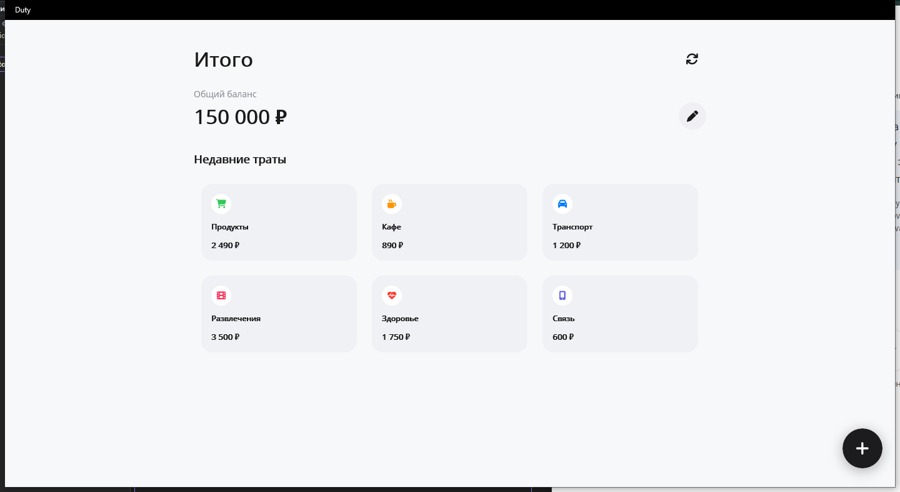
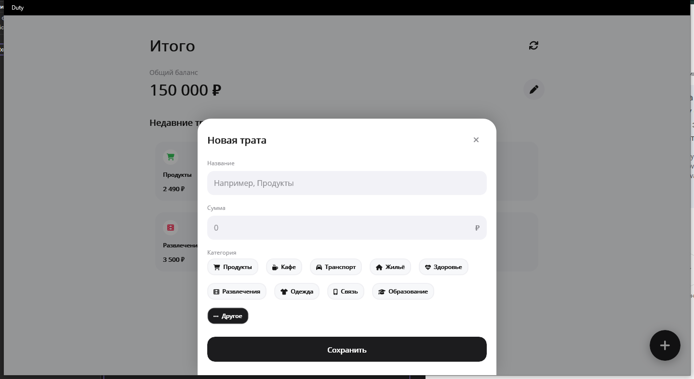
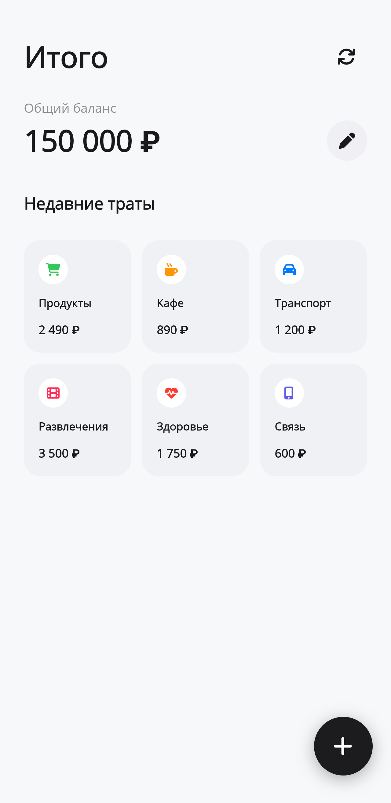

# Duty — учёт трат на .NET MAUI

Одностраничное приложение по макету `MainPage.xaml`: общий баланс, сетка недавних трат
по три карточки в ряд и плавающая кнопка добавления. Реализовано на **.NET MAUI 10**
с архитектурой **MVVM** и хранением данных в **JSON-файле**.







## Возможности

- Просмотр общего баланса и списка трат (сортировка от новых к старым).
- Добавление траты: название, сумма, категория (10 категорий с иконками Font Awesome).
- Редактирование траты по нажатию на карточку.
- Удаление траты с подтверждением; сумма возвращается на баланс.
- Редактирование общего баланса по кнопке-карандашу.
- Обновление данных из JSON-файла по кнопке в шапке.
- Валидация формы: пустое название, нулевая/некорректная сумма.
- Русское форматирование денег: `150 000 ₽`, `1 234,50 ₽`; ввод принимает `,`, `.` и пробелы.
- Пустое состояние списка, индикатор загрузки, светлая тема оформления.
- Транзакционное сохранение: при ошибке записи изменения не применяются к экрану.

## Архитектура

```
Duty/
├── Common/
│   └── MoneyFormatter.cs          # формат и разбор сумм (ru-RU)
├── Models/
│   ├── DutyData.cs                # корень JSON
│   ├── Expense.cs                 # трата
│   ├── ExpenseDraft.cs            # данные из формы
│   └── ExpenseCategory.cs         # справочник категорий
├── Services/
│   ├── IDutyDataService.cs
│   ├── JsonDutyDataService.cs     # чтение/запись JSON, backup, карантин
│   ├── IDialogService.cs
│   └── DialogService.cs           # системные подтверждения
├── ViewModels/
│   ├── MainViewModel.cs           # состояние страницы и сценарии
│   ├── ExpenseEditorViewModel.cs  # форма добавления/редактирования
│   ├── BalanceEditorViewModel.cs  # форма баланса
│   ├── ExpenseItemViewModel.cs    # карточка траты
│   └── CategoryOptionViewModel.cs # чип категории
├── MainPage.xaml                  # разметка из макета + оверлеи форм
├── MainPage.xaml.cs               # только InitializeComponent + запуск загрузки
├── MauiProgram.cs                 # DI, шрифты, обработчики
└── Resources/Fonts/fa-solid-900.ttf
```

- **MVVM**: представление не содержит бизнес-логики; команды и состояние — во ViewModel.
- **DI**: сервисы и ViewModel регистрируются в `MauiProgram`; `MainPage` получает `MainViewModel`.
- **CommunityToolkit.Mvvm 8.4.2**: `[ObservableProperty]`, `[RelayCommand]`.
- **Без навигации**: добавление, редактирование и баланс открываются поверх страницы,
  поэтому приложение остаётся одностраничным.

## Хранение данных

Файл JSON создаётся автоматически при первом запуске:

- Windows: `%LOCALAPPDATA%\Duty\duty-data.json`
- Android / iOS / Mac Catalyst: `FileSystem.AppDataDirectory/duty-data.json`

Структура:

```json
{
  "schemaVersion": 1,
  "totalBalance": 150000,
  "expenses": [
    {
      "id": "00000000-0000-0000-0000-000000000000",
      "name": "Продукты",
      "amount": 2490,
      "categoryKey": "groceries",
      "createdAt": "2026-11-14T00:00:00+03:00"
    }
  ],
  "updatedAt": "2026-11-14T00:00:00+03:00"
}
```

Особенности `JsonDutyDataService`:

- запись через временный файл и `File.Move` (атомарная замена);
- предыдущая версия сохраняется в `duty-data.json.bak`;
- повреждённый JSON перемещается в `duty-data.json.corrupt-<дата>`, затем читается backup;
- чтение и запись защищены `SemaphoreSlim`;
- кириллица в файле не экранируется (`UnsafeRelaxedJsonEscaping`), файл читаем глазами;
- при первом запуске создаются демонстрационные данные (баланс 150 000 ₽ и 6 трат).

Сброс к демо-данным: закрыть приложение, удалить `duty-data.json`, запустить снова.

### Правила баланса

- Новая трата уменьшает баланс на её сумму.
- Удаление траты возвращает её сумму на баланс.
- Редактирование траты корректирует баланс на разницу старой и новой суммы.
- Ручное изменение баланса задаёт текущую доступную сумму.

## Шрифт Font Awesome

В макете используются иконки Font Awesome. В проект добавлен файл
`Resources/Fonts/fa-solid-900.ttf` (Font Awesome 6 Free Solid) и регистрация в `MauiProgram.cs`:

```csharp
fonts.AddFont("OpenSans-Regular.ttf", "OpenSansRegular");
fonts.AddFont("OpenSans-Semibold.ttf", "OpenSansSemibold");
fonts.AddFont("fa-solid-900.ttf", "FontAwesome");
```

Иконки в XAML задаются как обычный текст, например `&#xf021;` (обновление),
`&#xf304;` (карандаш), `&#xf067;` (плюс). Категории используют коды `f07a`, `f7b6`,
`f1b9`, `f015`, `f21e`, `f008`, `f553`, `f3cd`, `f19d`, `f141`.

### Windows: исправление для unpackaged-приложения

У unpackaged-приложения Windows (в проекте стоит `WindowsPackageType=None`) MAUI
не применяет alias `FontAwesome` к `Label`/`Button`, и PUA-символы рисуются
пустыми квадратами. Это известная проблема MAUI для unpackaged-приложений
([dotnet/maui#9104](https://github.com/dotnet/maui/issues/9104)); workaround
взят из [Telerik KB](https://www.telerik.com/maui-ui/documentation/knowledge-base/troubleshooting-missing-fonts-unpackaged-deployment).
В `MauiProgram.cs` добавлен Windows-only mapping обработчиков:

```csharp
LabelHandler.Mapper.AppendToMapping("DutyFontAwesomeLabel", (handler, view) =>
{
    if (view is Label label && UsesFontAwesome(label.FontFamily)
        && handler.PlatformView is Microsoft.UI.Xaml.Controls.TextBlock platformLabel)
    {
        platformLabel.FontFamily =
            new Microsoft.UI.Xaml.Media.FontFamily("fa-solid-900.ttf#Font Awesome 6 Free");
    }
});
```

Аналогичный mapping есть для `ButtonHandler`. WinUI получает файл шрифта
напрямую в формате `font.ttf#FamilyName`, поэтому иконки работают и в
unpackaged-сборке. Android в этом не нуждается — там alias работает штатно.

Лицензия Font Awesome Free — в файле [THIRD-PARTY-NOTICES.txt](THIRD-PARTY-NOTICES.txt).

## Запуск

Требования: .NET 10 SDK, рабочая нагрузка `.NET MAUI`.

```powershell
dotnet restore
dotnet build Duty\Duty.csproj -f net10.0-windows10.0.19041.0
```

Visual Studio: открыть `Duty.slnx`, выбрать профиль **Windows Machine** и запустить.

### Android

Нужны Android SDK и JDK 17+ (проверено на JDK 21 и Android SDK build-tools 36).
В Visual Studio достаточно выбрать Android-эмулятор и нажать Run — студия сама
развернёт сборки через fast deployment.

Из командной строки:

```powershell
# Сборка, установка и запуск на подключённом эмуляторе
dotnet build Duty\Duty.csproj -f net10.0-android -t:Install
```

Если нужен **автономный APK** для ручной установки через `adb install`, включите
встраивание сборок, иначе Debug-APK с fast deployment не запустится:

```powershell
dotnet build Duty\Duty.csproj -f net10.0-android -p:EmbedAssembliesIntoApk=true
adb install -r Duty\bin\Debug\net10.0-android\com.companyname.duty-Signed.apk
```

Проверено на эмуляторе `sdk_gphone64_x86_64`, Android 16 (API 36): карточки,
цветные иконки категорий, шапка и FAB отображаются корректно.

## Как пользоваться

- **+** в правом нижнем углу — добавить трату.
- Нажатие на карточку — изменить или удалить трату.
- Карандаш рядом с балансом — изменить общий баланс.
- Кнопка обновления в шапке — перечитать JSON-файл.

## Примечания по реализации

- `CollectionView.EmptyView` на Windows приводит к падению WinUI в MAUI 10,
  поэтому пустое состояние показывается в заголовке коллекции и управляется
  свойством `HasNoExpenses`.
- Ширина контента ограничена 820 px и центрируется, чтобы на десктопе карточки
  не растягивались; на телефоне сетка занимает всю ширину.
- Для сохранения светлого макета тема принудительно выставлена в `AppTheme.Light`.
- На Windows у `Entry` убрана стандартная рамка WinUI, чтобы поля выглядели
  как скруглённые серые блоки из макета.
- Если после обновления на Android виден старый интерфейс, удалите приложение
  с эмулятора или очистите его данные и разверните заново: fast deployment
  хранит сборки в каталоге приложения и может пережить переустановку APK.
